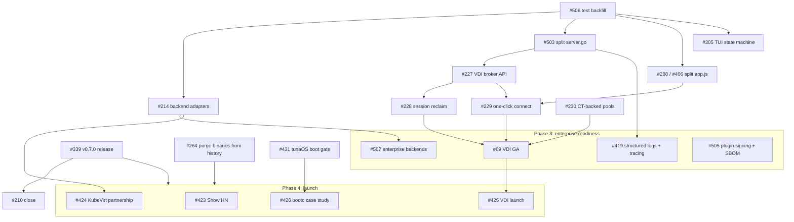

# Corral Roadmap

**Last updated**: 2026-10-15 | **Maintainer**: tuna-os (hanthor) / architect agent

---

## Mission

Corral herds VMs — and containers — into your tailnet. Corral is a single Go binary
with a CLI, TUI, and web dashboard. It manages VMs across five backends (qemu,
kubevirt, incus, libvirt, proxmox). It exposes every guest over the Tailscale
network that your devices already share. Developers also use it to boot-gate tunaOS
images on a KubeVirt cluster (`scripts/boot-gate.sh` in tunaOS).

---

## Current Status (2026-10-15)

- Corral is a Go rewrite of the legacy Python `tailvm`. On-disk names keep
  the `tailvm-` prefix during the transition ([SPEC.md](SPEC.md)).
- Corral supports five backends. The `bootc` mode builds a disk from a
  bootable container on the cluster. Then it runs that disk as a KubeVirt VM.
- 🟡 **Org CI adoption is not complete.** tunaos#1273 closed without a merge.
  The tunaOS CI boot gate (`reusable-build-image.yml`) uses
  `scripts/iso-e2e.sh`, not Corral. See #431.
- 🟡 **v0.7.0 notes are on main**
  ([docs/releases/v0.7.0.md](docs/releases/v0.7.0.md)). A maintainer must
  push the tag and publish the GitHub Release (#339).
- The repo has no milestones. This file and the issue labels track the work.

### Priorities

| Priority | Item | Tracking | Status |
|----------|------|----------|--------|
| P0 | Publish v0.7.0 (tag + GitHub Release) | #339, #210 | 🟡 Notes merged; tag not pushed |
| P1 | tunaOS CI boot-gate adoption | #431 | 🔴 Open |
| P1 | VDI plugin GA | #69 | 🟡 Phase 1 done; Phase 2 open |
| P2 | Plugin signing and SBOM | #505 | 🔴 Open |
| P3 | Dependency hygiene | #97 | 🟢 Ongoing (Renovate) |

---

## Roadmap (dependency order)

Each phase starts when the phases it depends on are done. Items in the same
phase do not depend on each other and can run in parallel.

### Phase 1: Release front door (now)

| Item | Issue | Depends on | Owner |
|------|-------|------------|-------|
| Push the `v0.7.0` tag and publish the Release from `docs/releases/v0.7.0.md` | #339 | — | maintainer |
| Close the release-channel finding after v0.7.0 shows on the Releases page | #210 | #339 | maintainer |
| Remove the 25 MB of binaries from git history (history rewrite) | #264 | — | maintainer (`needs-human`) |
| tunaOS CI boot gate: move `reusable-build-image.yml` from `iso-e2e.sh` to Corral | #431 | — (cross-repo) | ci-maintainer |

### Phase 2: Foundations (tests first, then refactors)

The refactors change large files with low test coverage. Land the test
backfill first so that each refactor has a safety net.

| Item | Issue | Depends on |
|------|-------|------------|
| Backfill tests, cheapest gaps first (RFC-0004) | #506 | — |
| Route all backend-specific code through `pkg/backend` (46 branches left; ratchet in `pkg/backend/matrix_test.go`) | #214 | #506 |
| Split `pkg/web/server.go`: routing, auth, task tracker, create logic | #503 | #506 |
| ✅ Split `app.js` into ES modules with node unit tests (`pkg/web/jstest`): API adapter #517, poll #523, session #525, console transports #531, workspace layout | #288, #406 | #506 |
| Make the TUI state machine its own type | #305 | #506 |

### Phase 3: Enterprise readiness (Q4)

[docs/enterprise-readiness.md](docs/enterprise-readiness.md) defines the
criteria for this phase (#404).

| Item | Issue | Depends on |
|------|-------|------------|
| VDI self-service broker API | #227 | #503 |
| VDI session tracking and reclaim | #228 | #227 |
| VDI one-click connect | #229 | #227, #288 |
| VDI CT-backed ephemeral pools | #230 | — |
| VDI GA | #69 | #228, #229, #230 |
| Plugin signing and SBOM verification | #505 | — |
| Structured logs and request tracing for CLI/TUI | #419 | #503 |
| Enterprise backends (RFC-0003) | #507 | #214 |

### Phase 4: Launch and outreach

Do not announce before the release is public and the history is clean. A
Show HN brings many first-time clones and installs.

| Item | Issue | Depends on |
|------|-------|------------|
| Show HN | #423 | #339, #264 |
| bootc case study | #426 | #339, #431 |
| VDI launch announcement | #425 | #69 |
| KubeVirt ecosystem positioning | #424 | #339, #214 |

---

## Done in 2026 Q3–Q4

- Backend parity for `move`: #163, #164, #123.
- Install path and macOS binaries: #315, #316.
- Web workspace epic #350: all child issues are done.
- Vendored asset provenance and SRI checks: #215, #396, #504.
- Path traversal in local VM names: #497, #502.
- Incus and libvirt commands, contexts and snapshots, and Proxmox create: #489–#493.
- Config cache and cross-process lock: #359.
- Enterprise readiness criteria
  ([docs/enterprise-readiness.md](docs/enterprise-readiness.md)): #404.

---

## Technical Debt Backlog

| Item | Issue | Priority | Effort |
|------|-------|----------|--------|
| `pkg/proxmox` (compat server) vs `pkg/proxmoxbe` (client) naming confusion | CONTEXT.md | P2 | S |
| Legacy `tailvm` prefix migration completion | SPEC.md | P2 | M |

## How to Contribute

Pick an item from the earliest phase that has open work. Earlier phases
hold all of its dependencies. The labels `needs-triage`, `ready-for-agent` and
`ready-for-human` show the state of each issue (see
`docs/agents/issue-tracker.md`).

## Roadmap Governance

The strategist agent keeps this file current after each milestone and each
quarter. To change it, open a PR that refers to an issue.

**Currency rule**: when an issue in this file closes, the same PR must move
its row, or the row must name a successor issue.
