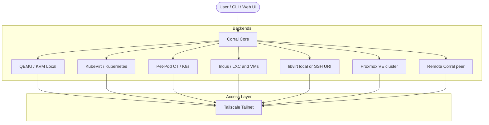
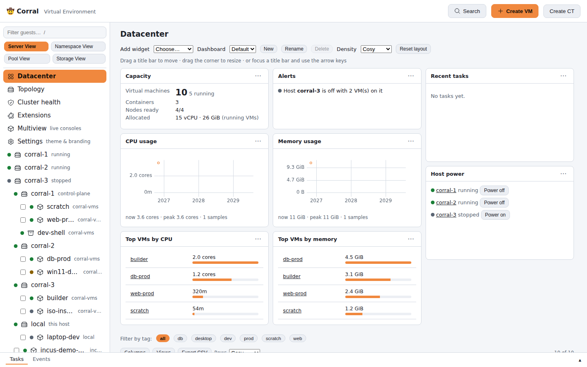
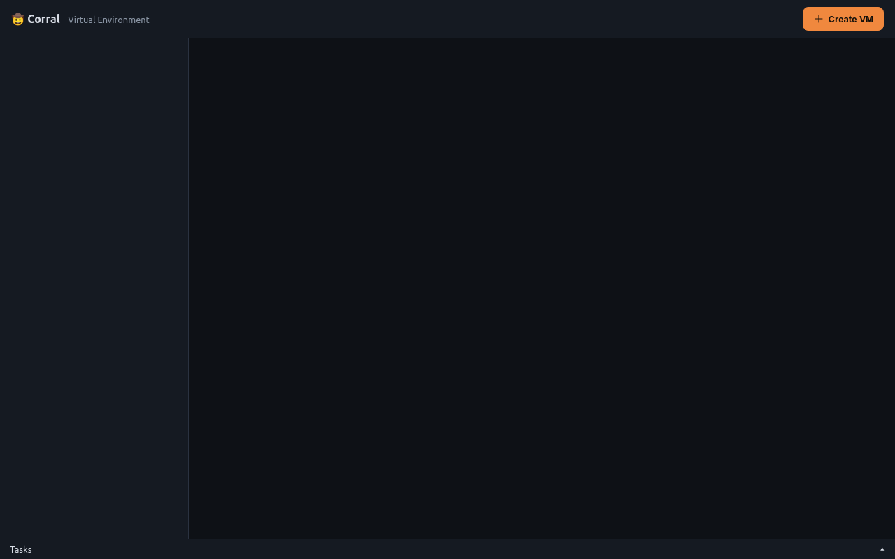
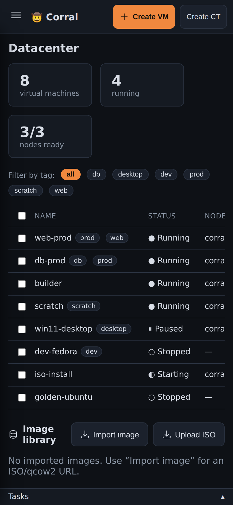
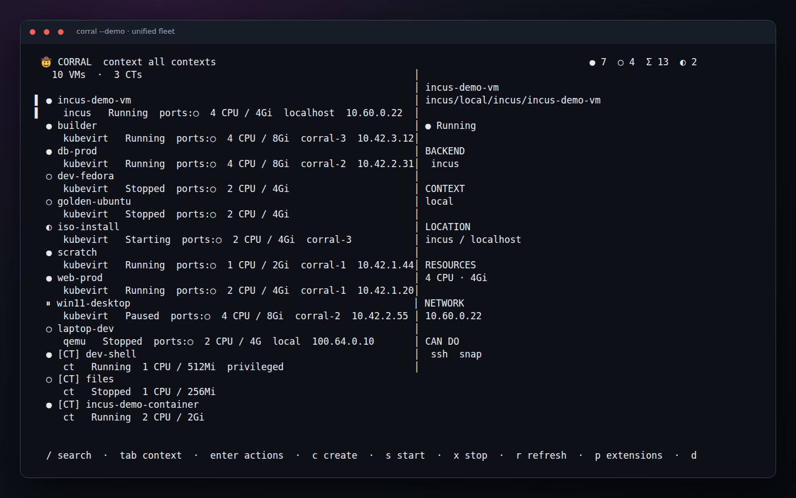
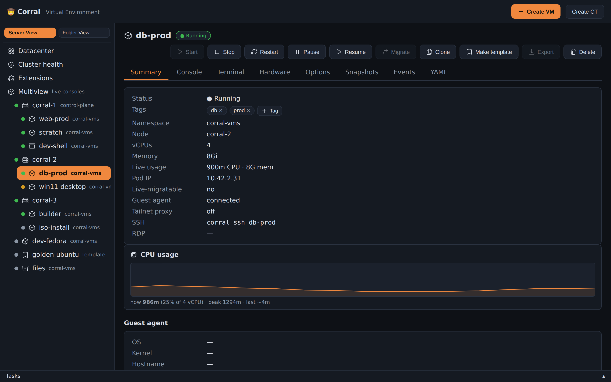
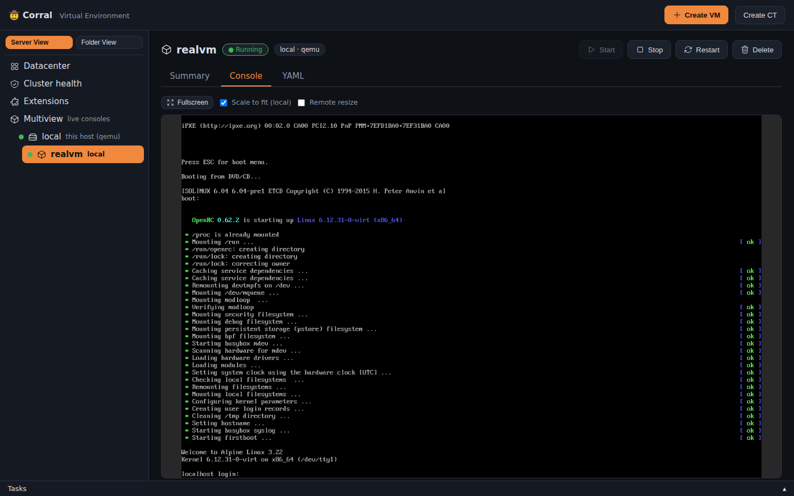

# Corral User Guide & Feature Manual

Welcome to the comprehensive user guide for **Corral** — the unified management platform for virtual machines, pet-pod containers, and local hypervisors.

## Backends, contexts, and peers

A *context* is a named connection to one backend. Examples are the local
host, a kube context, an Incus remote, a libvirt URI and a Proxmox VE
cluster. Corral shows the instances of all contexts at the same time.

```bash
corral setup                                  # find the backends on this host and save them
corral context list                           # the * marks the default destination
corral context add hv --backend libvirt --context qemu+ssh://hypervisor/system
corral context use hv                         # aliases: set, switch
corral config set-default-backend incus       # backend for creates with no backend flag
```

`corral context use` takes a context name, not a URI. It does not change
kubectl or the Incus client. The global `--context NAME` flag selects a
context for one command.

A local dashboard can aggregate an in-cluster Corral without a local
kubeconfig:

```bash
corral peer add homelab https://corral.example.ts.net
```

For a console, Corral tries the direct address that the VM advertises first.
It relays through the peer only when direct access is not available.

## Start here

Run `corral --demo`, `corral web --demo` or `corral list --demo` to try
Corral with a built-in fake fleet. Then pick the backend that you have.

| Backend | Setup guide |
|---|---|
| Local QEMU/KVM | No setup. Run `corral doctor --context local` |
| KubeVirt | [kubevirt-proxmox-setup.md](kubevirt-proxmox-setup.md) |
| Incus | [incus-backend-setup.md](incus-backend-setup.md) |
| libvirt | [libvirt-backend-setup.md](libvirt-backend-setup.md) |
| Proxmox VE | The commands below, and [ADR-0009](adr/0009-proxmox-backend.md) |

**Local QEMU/KVM** — a VM on this machine, under a systemd user unit:

```bash
corral create scratch --iso ~/Downloads/ubuntu-24.04.iso --disk 40G --start
corral viewer scratch          # VNC, to run the installer
corral ssh scratch             # after the guest has an SSH server
```

**KubeVirt** — a VM on the cluster of your current kube context:

```bash
corral doctor
corral create web --kubevirt --image fedora
corral start web
corral ssh web -u fedora
```

**Incus** — a VM on an Incus remote:

```bash
corral context add lab --backend incus --context local
corral create web --context lab --image images:ubuntu/24.04 --mem 4GiB
corral ssh web                 # runs incus exec
```

**libvirt** — a domain on a local or remote hypervisor:

```bash
corral context add hv1 --backend libvirt --context qemu+ssh://admin@hv1.example.net/system
corral create db --context hv1 --iso /var/lib/libvirt/images/debian-12.iso
corral list
```

**Proxmox VE** — the guests of an existing cluster:

```bash
corral context add pve --backend proxmox --context pve.example.net
export CORRAL_PROXMOX_TOKEN='corral@pve!corral=TOKEN-SECRET'
corral doctor --context pve
corral list
```

Corral reads the Proxmox token from `CORRAL_PROXMOX_TOKEN`, or from
`proxmox.token` in the context entry of `~/.config/corral/config.yaml`.
`corral create NAME --context pve --iso local:iso/debian.iso` creates a VM on
Proxmox. The ISO must already be on a PVE storage, named by its volume id.
A backend that the CLI cannot create on (VirtualBox, vSphere, Xen, Nutanix)
stops with `create is not supported on backend NAME from the CLI`; Corral
never creates the VM on a different backend instead.

## Common workflows

### CLI, TUI or web UI

The CLI, the TUI and the web UI use the same inventory and the same
configuration. Use the interface that fits the task:

| Interface | Use it to |
|---|---|
| CLI (`corral COMMAND`) | Write scripts and CI jobs. Add `--json` for machine-readable output |
| TUI (`corral`) | Look at the whole fleet in a terminal, and do actions from a menu that shows only the operations that the backend supports |
| Web UI (`corral web`) | Use consoles in the browser, dashboards and graphs, and access from a phone |

Some operations have a gap on one interface. For example, Incus and libvirt
snapshots work in the TUI only. See
[backend support](backend-support.md#incus-and-libvirt-snapshots-migration-and-hotplug).

### Create, connect and remove

```bash
corral create web --kubevirt --image fedora
corral list                              # status, context and the ID of each instance
corral info web
corral ssh web -c 'uptime'               # one command, no shell
corral ssh web -L 8080:localhost:80      # open http://localhost:8080 for port 80 of the VM
corral stop web
corral delete web                        # asks first; -f does not ask
```

When two contexts have an instance with the same name, give the ID from the
`id:` line of `corral list` instead of the name.

### Clone a VM and use templates (KubeVirt)

```bash
corral clone web web-copy
corral images pull ubuntu                # a stopped VM with the template mark
corral template ls
corral template new tmpl-ubuntu dev1     # a new VM from the template
corral template mark web                 # use your own VM as a template
```

Clone and templates work on KubeVirt only. On other backends, use a cold
move or the native clone command of the backend.

### Move a VM to another backend

`corral move` copies the disk to another backend and makes a VM there. It is
a cold move: the guest stops, and it gets a new MAC address and usually a new
IP address. The source stays, stopped, unless you add `--delete-source`.

```bash
corral move web --to libvirt --dry-run   # the plan and the warnings, no change
corral move web --to libvirt
corral move web --to qemu --name web-local
```

To move a KubeVirt VM to another node of the same cluster with no stop, use
`corral migrate web --node NODE`.

### Snapshots

```bash
corral snapshot create web
corral snapshot ls web
corral stop web
corral snapshot restore web SNAPSHOT
corral snapshot rm web SNAPSHOT
```

The `corral snapshot` commands work on KubeVirt. For local QEMU, Incus and
libvirt instances, use the **Snapshots** action in the TUI.

### Install plugins

Plugins add workflows that not every user needs. They install into
`~/.local/share/corral/plugins` and run as `corral NAME`.

```bash
corral plugin search
corral plugin info backup
corral plugin install backup
corral plugin update                     # every plugin that you did not pin
```

If a plugin asks for permissions, `corral plugin install` stops and names
them. Read them with `corral plugin info NAME`, then add
`--accept-permissions`.

| Plugin | Install it when | First commands |
|---|---|---|
| `bootc` | You boot bootable container images as VMs | `corral bootc create dev --image bluefin` |
| `backup` | You keep VM disks in S3, R2 or another rclone remote | `corral backup create web --dest r2:backups/corral`, `corral backup list` |
| `windows` | You install Windows guests with UEFI, TPM and virtio drivers | `corral windows requirements`, `corral windows create win11 --iso URL` |
| `gpu` | You give a GPU or another PCI device to a VM | `corral gpu list`, `corral gpu attach web --device ID` |

[first-party-plugins.md](first-party-plugins.md) lists the backends that each
plugin supports.

### When something fails

Run `corral doctor`, then look for the error text in
[problems and fixes](troubleshooting.md).

---

## 1. Overview & Architecture

Corral puts VMs and containers from many backends into one interface, one CLI, and one Tailscale network.



### Supported Compute Backends

| Backend | Scope | Tech Stack | Use Case |
|---|---|---|---|
| **QEMU** | Local Host | QEMU / KVM + systemd | Fast, local ephemeral or dev VMs on your workstation |
| **KubeVirt** | Cluster | KubeVirt + Kubernetes | Production VMs with live migration, PVC storage, and scaling |
| **Container (CT)** | Cluster | Kubernetes Pod + PVC | "Pet Pods" — persistent Linux containers (Distrobox on K8s) |
| **Incus** | Local or remote | Incus remote | Containers and VMs managed through existing Incus trust |
| **libvirt** | Local or remote | libvirt URI / OpenSSH | Existing domains and remote QEMU hypervisors |
| **Proxmox VE** | Cluster | Proxmox VE HTTPS REST API | VMs and LXC containers managed on existing PVE clusters |

---

## 2. Interactive Interfaces

### Web Dashboard

Run `corral web`, then open the Proxmox-style web UI on port 8006 of `localhost`. For public, local, homelab, and always-on setups see [deployment modes](deployment-modes.md).





#### Features:
- **Datacenter Tree**: Navigate through all VMs, CTs, and Incus instances across local and cluster nodes.
- **Live CPU & Memory Sparklines**: Real-time load graphs for each VM.
- **Tag Filters**: Filter instances by custom tags (`prod`, `dev`, `desktop`).
- **Mobile Responsive**: Manage your VM fleet from your mobile browser.
- **Theme & Brand**: Customize accent colours and the header brand, and inject custom CSS. Use CLI flags, a config file, or the built-in Settings page.



#### Topology

Topology, under Datacenter in the tree, draws the fleet as the machines it
runs on. Each node is a card, with its guests inside and the CPU and memory
they take summed at the top. A tile's left edge shows the guest's state.

To migrate a guest, drag its tile onto another node's card. corral asks you
to confirm first. If it cannot make the move, it says why and refuses it. The
keys `g` then `t` open the topology from anywhere.

#### Several dashboards

A Datacenter or node screen can hold more than one dashboard. Use the picker
above the widgets to switch, and New to add one. Each dashboard keeps its own
arrangement and its own density. So you can keep one screen for capacity and
another for a failure you need to chase.

Rename changes the name of the current dashboard. Delete removes it and its
arrangement; the widgets stay available under Add widget. A screen always
keeps at least one dashboard, so the last one does not delete.

Dashboards live in your own browser, like the rest of the layout. corral
shares them with nobody.

#### Dashboard density

The Density control above a dashboard sets how much room each widget takes:
Compact, Cosy or Roomy. Compact fits more on one screen. Each dashboard keeps
its own choice, and Reset layout puts it back with the arrangement.

#### Links to a screen

The address bar follows what you look at. Select a guest and open its console,
and the address holds both. Send that address to somebody else and they arrive
on the same screen. The back and forward buttons move through the screens you
visited.

The address carries the tree view, the selection and the open tab. On a screen
with the guest list, it also carries the list's filters and sort. So you can
send somebody the stopped guests on one node, sorted by memory. It does not
carry how wide you keep the sidebar, which columns you hid, or where you put
the dashboard widgets. Those stay in your own browser.

#### Web keyboard shortcuts

Press `Ctrl+K` (`⌘K` on macOS) to open the command palette. Type part of a
name to find a VM, a CT, a node or a pool. Type a verb and a name to find an
action, for example `stop web-prod`. Press `Enter` to run the first result.
The items that you used last show at the top of the list.

| Key | Action |
|---|---|
| `Ctrl+K` | Open the command palette |
| `Ctrl+B` | Hide or show the sidebar |
| `?` | Show the list of shortcuts |
| `/` | Filter the tree by guest name |
| `c` | Open the console of the selected VM |
| `s` | Start or stop the selected VM |
| `g` then `d` | Go to the datacenter |
| `g` then `t` | Go to the topology |
| `v` | Switch the tree to the next view |
| `t` | Show the Tasks panel, and hide it again |
| `e` | Show the Events panel for the selection, and hide it again |

You can also narrow the palette by a field. Type `node=corral-1` to see only
the guests on that node, or `status=stopped` to see the stopped ones. The
fields are `node`, `namespace`, `status`, `backend` and `tag`. A field and a
name work together: `node=corral-1 web` searches only that node.

The one-key shortcuts do not operate when you type in a field or in a console.
A read-only user does not see the actions that change a guest.

#### Theme & Branding

In Corral's web UI, you can fully customize the accent colour, the header
brand, and custom CSS. You need no source-code changes.

**CLI flags** (highest priority, override everything):
```bash
corral web --accent \"#3b82f6\" --brand-title \"My Lab\" --brand-emoji \"⚡\" --brand-subtitle \"Engineering\"
```

**Config file** (`~/.config/corral/config.yaml`, loaded on startup):
```yaml
web:
  accent: \"#22c55e\"        # CSS hex colour
  accent_2: \"#16a34a\"      # hover/active variant
  brand_title: \"My Lab\"
  brand_emoji: \"⚡\"
  brand_subtitle: \"Engineering\"
  custom_css: |
    .btn.primary { border-radius: 20px; }
    .card { background: var(--panel-2); }
```

**Settings page** (web UI → Settings in the sidebar):
- Colour picker with preset swatches (Orange, Blue, Green, Purple, Red, Amber)
- Brand title, emoji, and subtitle fields with live header preview
- Custom CSS textarea that injects styles immediately as you type
- Save button persists to `config.yaml`

Precedence: CLI flags > config.yaml > built-in defaults (🤠 Corral, orange
accent).

---

### Terminal UI (TUI)

To launch the interactive TUI (built on Bubble Tea), run `corral` with no arguments. To explore in demo mode, run `corral --demo`.



The left side is a unified, searchable fleet. Wide terminals add a details
pane with canonical ID, backend/context, placement, address, resources, and
available operations. Failed remotes appear as partial-fleet warnings without
hiding healthy instances.

#### TUI keyboard shortcuts and features

- `/` fuzzy-searches names, canonical IDs, backends, contexts, nodes, and IPs.
- `Tab`, `[` and `]` cycle between the complete fleet and named contexts.
- `Enter` opens a capability-aware action menu. The menu leaves out
  unsupported operations, so they do not fail after you select them. These
  all live there: power (start/stop/restart/pause/resume), migrate, clone,
  snapshots, and events. So do the template mark, CPU/RAM, published ports,
  export, SSH, VNC, and delete.
- **Snapshots** opens the instance's captures: `n` takes one (named or
  auto-named), `Enter` restores, `x` deletes, `r` reloads. Corral supports every backend
  that can snapshot: KubeVirt, libvirt, Incus, and local QEMU. Each capture
  reports what it caught (offline, filesystem, or crash-consistent). This is
  the same as the web UI's Snapshots tab.
- **Events** shows the recent Kubernetes events for a KubeVirt VM and its
  `virt-launcher` pod, newest first.
- **Make/Unmark template** flips the golden-template label that
  `corral clone` copies from.
- CTs get their own smaller menu — start, stop, console, CPU/RAM, delete.
- `s` and `x` quickly start or stop the selected VM; `r` refreshes every
  backend.
- `d` runs scoped QEMU, KubeVirt, Incus, and libvirt diagnostics.
- The mouse works too. Click a row to select it, and scroll with the wheel.
  Double-click to open its actions (or to run the highlighted one). A click
  on a port row in the ports form toggles it. Destructive actions still go through
  their confirmation — a double click can't reach anything a keypress can't.
- `?` opens the in-app command deck.
- QEMU, KubeVirt, Incus, libvirt, and pet-pod CTs share the inventory without
  losing their backend-specific capabilities.

---

## 3. Core Feature Walkthrough

### 1. Instance Lifecycle Management

Create and manage instances across any backend with identical commands:

```bash
# Create local QEMU VM
corral create dev-vm --iso https://example.com/ubuntu.iso --disk 40G

# Create KubeVirt cluster VM
corral create prod-vm --kubevirt --image fedora

# Create on an existing Incus remote
corral create fast-vm --backend incus --context lab --image images:ubuntu/24.04

# Universal operations
corral start dev-vm
corral stop dev-vm
corral delete dev-vm
```

---

### 2. Remote Access: VNC, RDP & TTY

Corral provides single-command remote access to guest displays and shells:

#### In-Browser & Local VNC


- **VNC Display**: `corral viewer <vm-name>` opens a VNC session. In the Web UI, `noVNC` shows the display in the browser, with nothing to install.
- **Interactive TTY / SSH**: `corral ssh <vm-name>` or `corral ct console <ct-name>` connects your terminal to a shell in the guest (through SSH, `virtctl ssh`, or `incus exec`).



---

### 3. Bootable Container Images (`bootc`)

Boot containers directly as VMs using the `bootc` plugin:

```bash
corral plugin install bootc
corral bootc create my-node --image quay.io/centos-bootc/centos-bootc:stream9
```

- Builds a bootable OS disk on the cluster with `bootc install to-disk`.
- Upgrade the OS image of a guest with `corral bootc upgrade <vm-name>`.

#### Testing a bootc image (`corral vmtest`)

`corral vmtest` boots an image locally and tests it. It needs no plugin, and
it is what a CI pipeline should call:

```bash
corral vmtest gate --bootc ghcr.io/tuna-os/yellowfin:latest \
  --user tester --password hunter2 --sudo-user \
  --check 'systemctl --failed --no-legend'
```

With the default `--keep` behavior, use the SSH command printed in the
summary. Its private key stays outside the artifact directory, so the uploaded
evidence does not expose it.

The run leaves the VM up, so the next step tests a real machine over SSH.
It also writes the guest's serial console, a screenshot of every stage of the
boot, an optional WebM timelapse, and `result.json`. Accounts, passwords,
packages and first-boot hooks go into a layer built on top of the image, which
is never modified. Full reference:
[docs/ci-boot-gate.md](ci-boot-gate.md).

---

### 4. Proxmox VE API Compatibility Layer

Corral includes a layer that emulates the REST API of Proxmox VE (`/api2/json/...`). With it, Terraform (`bpg/proxmox`), Ansible, and Proxmoxer tools can manage KubeVirt and Incus instances natively.

```bash
corral plugin install proxmox
corral proxmox serve --addr :8006
```

---

### 5. Plugin Marketplace

Expand Corral with lightweight marketplace plugins:

```bash
# Browse marketplace
corral plugin search

# Installed plugins
corral plugin list

# Plugin management
corral plugin install <name>
corral plugin remove <name>
```

#### Available Plugins:
- `bootc`: Builds VMs from bootable container images.
- `proxmox`: Compatibility server for the REST API of Proxmox VE.
- `backup`: S3/R2 VM disk backup & restore.
- `snapsched`: Automated schedules for VM snapshots, with retention rules.
- `schedule`: VM autostart and shutdown cron windows.
- `gpu`: GPU / PCI passthrough, via discovery of the device plugin.
- `windows`: First-class creation of Windows VMs (UEFI, TPM, virtio drivers).
- `vdi`: Desktop pools for Virtual Desktop Infrastructure (VDI).

#### Plugin screens and widgets

Some plugins add screens and dashboard widgets to the web UI. The Extensions
screen shows what each plugin adds, before and after you install it.

- A plugin widget does not appear on its own. Add it from "Add widget" on the
  Datacenter dashboard.
- A plugin screen opens from "Added by plugins" on the Extensions screen, or
  from the command palette.
- A plugin screen is read-only. It shows information, and it cannot change the
  fleet.
- If a plugin does not answer, the widget or screen tells you why. Click "Try
  again" to ask again.

---

## 4. Diagnostics & Troubleshooting

Run `corral doctor` to diagnose cluster capabilities, hypervisor support, and storage drivers:

```bash
corral doctor
```

In a multi-context setup it diagnoses every configured QEMU, KubeVirt, Incus,
libvirt, and Proxmox target. Use `corral doctor --context NAME` for one target. The
complete capability matrix and the direct-versus-relayed networking behavior
are in [backend-support.md](backend-support.md).

```text
local [qemu]
  ✓ QEMU (local backend)              qemu-system-x86_64 found (probe 2ms)
  ✓ KVM acceleration                  /dev/kvm accessible
  ✓ qemu-img                          found — disk create/resize for local VMs

kubevirt [kubevirt]
  ✓ KubeVirt installed                operator + CR present (probe 41ms)
  ✓ CDI installed                     containerized-data-importer present
  ✓ VolumeSnapshotClass               persistent-VM snapshots available

lab [incus]
  ✓ Incus remote reachable            remote API and trust are valid (probe 18ms)
  ✓ Incus VM support                  virtual-machine instances supported
```

[Problems and fixes](troubleshooting.md) explains each check, the common
error messages, and how to collect evidence when a VM does not boot.

## Reproducible screenshots

Documentation captures use the real demo fleet that is built in. They are automated
for both Chromium and the Bubble Tea TUI:

```bash
npm install --prefix e2e
node scripts/capture-docs.mjs docs/screenshots/generated
```

The same command can target the TunaOS site checkout:
`node scripts/capture-docs.mjs ../docs/static/img/screenshots/corral`.

The `Screenshots` workflow runs this script when the web UI, the TUI or the
demo fleet changes, and one time each week. It then opens a PR with the new
images. When the `TUNAOS_DOCS_TOKEN` secret is set, it also opens a PR in
tuna-os/docs. That PR updates the images on the TunaOS site.
